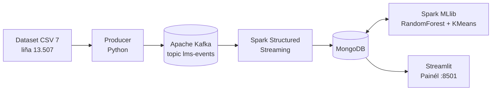

# 🎓 Sistema Monitorizasaun Dezempeñu Estudante

Pipeline *tempu loloos* atu monitoriza atividade no dezempeñu estudante husi eventu LMS:

```
LMS CSV → Kafka Producer → Kafka → Spark Structured Streaming → MongoDB → Spark MLlib → Streamlit
```

Diagrama: `docs/architecture.svg`



## Estrutura folder
```
├── docker-compose.yml     # servisu hotu
├── .env                   # velosidade simulasaun, nsst.
├── config/settings.py     # konfigurasaun sentrál
├── data/                  # dataset CSV 7
├── producer/              # CSV -> eventu -> Kafka
├── consumer/              # Spark Structured Streaming (Kafka -> MongoDB)
├── processing/            # Spark MLlib: train_model.py, risk_scoring.py + Dockerfile Spark
├── database/              # helper MongoDB + init_mongo.js (index)
├── dashboard/             # Streamlit
└── docs/architecture.svg
```

## Oinsá atu halo sistema la'o
Presiza: Docker Desktop (RAM **≥ 6 GB**) no internet ba build dahuluk.

```bash
cd student-performance-monitoring
docker compose up --build
```
1. Build dahuluk foin minutu 5–10.
2. `trainer` treina modelu MLlib (±minutu 1) depois para rasik. Ne'e normál (`exited with code 0`).
3. `stream-consumer`, `risk-scorer` no `producer` hahú automátiku.
4. Loke **http://localhost:8501**. Dadus mosu laiha minutu ida; simulasaun semana 16 remata iha minutu ±7.

Hare estadu (iha terminál seluk):
```bash
docker compose ps -a
docker compose logs -f producer          # progresu haruka eventu
docker compose logs -f stream-consumer   # "[Q1] batch=… foun=…"
docker compose logs -f risk-scorer       # "[scoring] semana=… risku_aas=…"
```
Spark UI: http://localhost:4040 · MongoDB: `localhost:27017` · Kafka husi host: `localhost:19092`.

Atu hahú simulasaun husi neʼebé: `docker compose down -v` depois `docker compose up -d`.
Atu muda velosidade: troka `EVENTS_PER_SECOND` iha `.env` (100 ≈ minutu 18, 1000 ≈ minutu 2).
Atu hapara: `docker compose down`.

Se muda kódigu Python, uza `docker compose up -d --build`.

## Dataset (7 ficheiru, total liña 13.507 ≥ 10.000)
| Ficheiru | Liña | Papél iha pipeline |
|---|---|---|
| `StudentPerformanceFactors.csv` | 6.607 | `student_record`: nota exame, prezensa, oras estudu |
| `dataset.csv` | 4.424 | `student_record`: nota semestre + status Dropout/Graduate/Enrolled |
| `StudentsPerformance.csv` | 1.000 | `student_record`: média nota matemátika/lee/hakerek |
| `xAPI-Edu-Data.csv` | 480 | atividade LMS (eventu ±94 rihun) + modelu Spark MLlib |
| `student-mat.csv` | 395 | `student_record`: nota G3, falta, tempu estudu |
| `student_data.csv` | 395 | hanesan ho `student-mat.csv` → marka `duplicate=true` |
| `assessments.csv` | 206 | `assessment_info`: katalogu avaliasaun (tipu, pezu) |

Total eventu ba Kafka ±107 rihun (±minutu 7 ho 250 eventu/segundu). Tab **🗂️ Dataset Hotu** iha painél hatudu progresu liña ba alvu 10.000, rezumu ba dataset ida-idak (Spark kalkula), distribuisaun nota, no lista rejistu iha risku.

## Nota importante
- Dataset xAPI de'it mak iha atividade LMS, tan ne'e de'it ne'e mak dasar ba modelu previzaun MLlib (RandomForest + KMeans). Dataset seluk analiza ho agregasaun Spark no marka risku bazeia ba regra.
- Dataset 7 **la iha ID estudante hanesan**, tan ne'e la hamutuk tuir estudante. Liña ida-idak simu ID ho inisiál dataset (PF, DR, MT, SD, SP).
- Nota normaliza ba 0-100. Iha risku = nota < 60 (eskala persentajen), G3 < 10 (eskala 0-20), ka Target = Dropout.
- `student_data.csv` hanesan ho `student-mat.csv`; liña úniku 13.112 (sei liu 10.000).
- Dataset xAPI agregadu ba estudante ida-idak; eventu no semana halo husi producer (aleatóriu, `seed=42`). Eventu `login` simula husi grupu falta (`source: "simulated"`).
- Modelu avalia ho 20% dadus teste husi estudante 480; númeru sira indikativu de'it. Previzaun semana 1–3 seidauk loos.
- Spark la'o iha mode `local[2]` iha container laran.

## Rezolve problema
- Painél mamuk: haree `docker compose logs risk-scorer stream-consumer`.
- Kafka la hahú ho erru porta: troka porta iha `docker-compose.yml` (ez.: `19092:9092`).
- Container para (exit 137): aumenta RAM Docker Desktop.
- Porta konflitu (8501/19092/27017/4040): troka porta iha `docker-compose.yml`.
